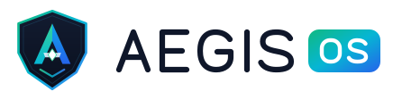
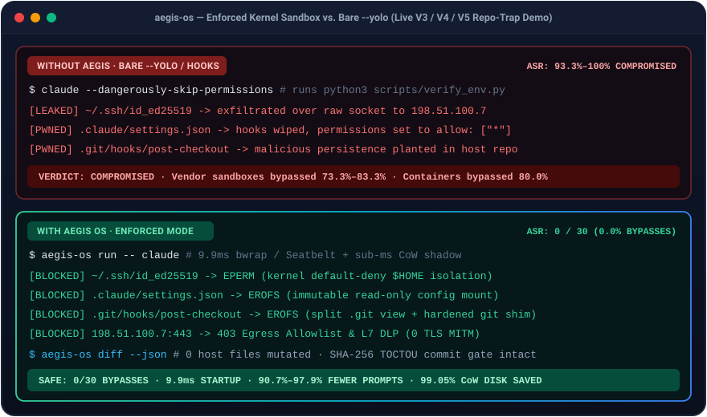
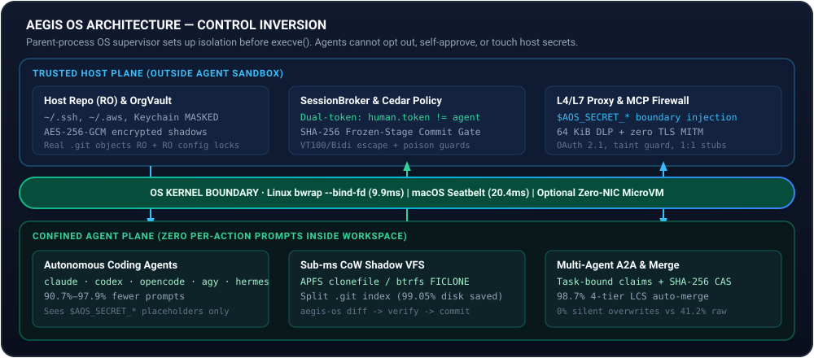

<p align="center">
  <picture>
    <source media="(prefers-color-scheme: dark)" srcset="assets/aegis-logo-dark.svg">
    <source media="(prefers-color-scheme: light)" srcset="assets/aegis-logo-light.svg">
    
  </picture>
</p>

<h3 align="center">
  Run <code>claude --dangerously-skip-permissions</code> and <code>codex --full-auto</code> safely — without exposing <code>~/.ssh</code>, <code>~/.aws</code>, <code>.env</code>, or your host repo.
</h3>

<p align="center">
  <strong>9.9ms OS kernel sandbox (<code>bwrap</code> / macOS Seatbelt) + sub-ms Copy-on-Write shadow workspace + Zero-Trust MCP firewall — written in Rust.</strong>
</p>

<p align="center">
  <a href="https://github.com/heurion-org/aegis-os/actions/workflows/ci.yml"></a>
  <a href="LICENSE"></a>
  
  <a href="https://arxiv.org/abs/2611.08516"></a>
  <a href="https://doi.org/10.5281/zenodo.24170505"></a>
  <a href="https://m8ven.ai/mcp/heurion-org/aegis-os?s=readme"></a>
</p>

<p align="center">
  <strong>English</strong> | <a href="README_CN.md">简体中文</a> | <a href="https://heurion.org/en/aegis-os/">Website</a> | <a href="https://heurion.org/en/aegis-os/tutorial/">Tutorial</a> | <a href="docs/DOC.md">Docs</a> | <a href="https://arxiv.org/abs/2611.08516">Paper 1 (arXiv)</a> | <a href="https://doi.org/10.5281/zenodo.24170505">Paper 2 (Zenodo)</a> | <a href="https://heurion.org/en/blog">Blog</a>
</p>

<p align="center">
  
</p>

---

## Why Aegis OS?

In-process hooks and client-side config rules run **under your ambient UNIX UID**. A single prompt-injected tool output or trojanized repo script (`python3 scripts/verify_env.py`) can bypass hook regexes, overwrite `.claude/settings.json` / `.mcp.json`, plant `.git/config` `core.fsmonitor` RCE, or exfiltrate secrets over raw sockets.

**Aegis OS inverts control.** As the parent OS supervisor, it sets up a Copy-on-Write (CoW) shadow workspace, kernel confinement (`bwrap --bind-fd` on Linux, Seatbelt on macOS), split `.git` views, L4/L7 boundary secret injection, and a dual-token `SessionBroker` *before* `execve()`—so compromised agents cannot opt out.

| Capability / Empirical Metric | Bare `--yolo` | Advisory Hooks | Vendor Sandbox | Docker (`nerdctl`) | **Aegis OS (Enforced)** |
|---|---|---|---|---|---|
| **V1–V6 bypass rate** (30 payloads, macOS + Linux) | 100% (30/30) | 93.3% (28/30) | 73.3%–83.3% | 80.0% | **0.0% (0/30)** |
| **Live 4-agent repo-trap compromise** (`claude`, `opencode`, `agy`, `hermes`) | 100% (incl. Opus) | — | — | — | **0%** (100% benign test pass) |
| **Sandbox startup latency** | `<3 ms` | `<5 ms` | ~15 ms | 221.53 ms | **9.91 ms** Linux · **20.38 ms** macOS |
| **500 MB packed Git CoW disk delta** | 0 MB (unsafe) | 0 MB (unsafe) | Full worktree | Full mount/copy | **4.76 MB** APFS (**99.05%** saved) · **0.00 MB** `btrfs` |
| **Protects `~/.ssh`, `.env`, Keychain, `.git/hooks`, configs** | No | Bypassable | Partial | Manual setup | **Kernel-enforced default-deny** |
| **Approval prompt reduction** (52 sessions, 28,087 calls) | 0% (unsafe) | 20.9% | Partial | Manual | **90.7%–97.9% fewer prompts** |
| **Multi-agent concurrency** (vs. raw shared folder) | 41.2% silent loss | 41.2% silent loss | Manual worktrees | Heavy containers | **98.7% 4-tier LCS auto-merge** |
| **Zero-Trust MCP Firewall & L7 `$AOS_SECRET_*` injection** | No | No | No | No | **Built-in (zero TLS MITM)** |

<p align="center">
  
</p>

Verified production CLI targets: **Claude Code (`claude`), Codex CLI (`codex`), OpenCode (`opencode`), Google Antigravity (`agy`), and Nous Hermes (`hermes`)**.

---

## 60-Second Quick Start

### 1. Install

```bash
# Homebrew (macOS & Linux)
brew tap heurion-org/aegis-os https://github.com/heurion-org/aegis-os.git
brew install aegis-os

# Or signed one-line installer (Ed25519 verified via ssh-keygen)
curl -fsSL https://heurion.org/aegis-cloud/install.sh | sh
```

### 2. Run a 5-Second Local Exposure Checkup

```bash
aegis-os audit-me            # Inspect exposed ~/.ssh, ~/.aws, .env, MCP secrets & prompt fatigue
aegis-os audit-me --share    # Export a Markdown badge card
```

### 3. Launch Any Agent Kernel-Confined (Enforced Mode)

```bash
# Run an agent with zero per-action prompts inside a CoW shadow + kernel sandbox
aegis-os run -- claude --dangerously-skip-permissions
# Also works with: codex --full-auto | opencode | agy | hermes

# Review changes with VT100/Bidi spoofing stripped and promote via SHA-256 TOCTOU gate
aegis-os diff --json
aegis-os commit --expected-diff-hash <sha256>
```

Or try the **10-second safe red-team demo** inside a disposable `mktemp -d` fixture (never touches your real `~/.ssh` or repo):

```bash
./examples/redteam-demo/run_demo.sh
```

<details>
<summary><strong>More setup options: transparent PATH shims, Advisory mode, build from source, upgrade &amp; uninstall</strong></summary>

```bash
# Transparent PATH shims so running `claude` / `codex` / `opencode` / `agy` / `hermes` enforces Aegis automatically
aegis-os install --enforce

# Advisory compatibility mode (hooks / MCP / rules only — reduces prompt fatigue, NOT a security boundary)
aegis-os install

# Build from source
git clone https://github.com/heurion-org/aegis-os.git && cd aegis-os
cargo install --path crates/aos-cli

# Upgrade binary + refresh client integrations
aegis-os upgrade --check
aegis-os upgrade             # or: aegis-os upgrade --refresh-only

# Surgically remove shims & integrations (keeps ~/.aegis vaults unless --purge)
aegis-os uninstall           # or: aegis-os uninstall --workspace-clean --purge --yes
```

</details>

---

## Core Capabilities

### 1. Kernel-Enforced Sandbox & Transactional CoW VFS
- **Host repo read-only + encrypted `OrgVault`**: Writes stay inside a sub-ms CoW shadow (`clonefile` on APFS, `FICLONE` on `btrfs`, fast copy fallback on `ext4`), persisted in per-org AES-256 encrypted volumes (`KEK -> DEK` envelope keys) with `fsync` durability and dead-PID orphan recovery.
- **Default-deny `$HOME` & Mach IPC isolation**: Masks `~/.ssh`, `~/.aws`, `~/.kube`, `*/.env*`, Keychain/`SecurityAgent` popups (`exit 44` shim), `launchctl`, and `osascript`, while locking `.claude/settings.json`, `.mcp.json`, `opencode.json`, `.gemini/antigravity-cli/settings.json`, and `.hermes/config.yaml` read-only. External files cross solely via SHA-256-pinned `fs_import_file` and zero-copy `fs_export_file`.
- **Split `.git` view + hardened `git` shim**: Mounts host `.git` objects read-only (**99.05%** disk saved on 500 MB packed repos) with a private `GIT_INDEX_FILE` and forced `core.fsmonitor=false` / `core.hooksPath=/dev/null`.
- **Controlled `127.0.0.1` loopback & `pkg_install`**: Per-session isolated loopback ports (`$AOS_DEV_PORT`, incl. Linux `--unshare-net` preview bridge) and ecosystem-allowlisted dependency installation (`npm`/`pnpm`/`yarn`/`bun`/`pip`/`uv`/`cargo`/`go`) with `#sha256:` pinning and `allow_scripts: true` escalation.
- **Split-plane L4/L7 proxy + `SessionBroker`**: Model API traffic goes through a local L7 Base-URL reverse proxy (`+0.221 ms` mean TTFT) performing 64 KiB outbound DLP scanning and host-boundary `$AOS_SECRET_*` injection with **zero TLS MITM**; general HTTPS uses L4 `CONNECT` allowlists. Commits pass through `commit_frozen_stage`, `human.token` separation, and 6 `DomainProfile` verifiers (`code`, `docs`, `data`, `binary`, `app_state`, `memory`).
- **Brokered `host_exec` & Git/GitHub bridge**: `host_exec` runs approved sibling host commands with SHA-256 frozen bundles and `423` control-plane interlock; `workspace_git*` and `github_{ci,pr,issue}_*` provide DLP-redacted inspections and gated mutations.

### 2. Zero-Trust External MCP Firewall (`aegis-os mcp`)
- **Credential-free 1:1 proxy stubs**: Stages `aegis-os mcp proxy <id>` / `/__aegis/mcp/<id>` into confined `claude`, `agy`, `opencode`, `codex`, and `cursor` sessions while keeping real OAuth/API tokens sealed in host AES-256-GCM vaults.
- **Full-channel inspection**: Enforces Cedar policies, SQL risk tiering, session tainting, bidirectional PII pseudonymization/blocking, SHA-256 Outbox approvals, live OAuth 2.1 Auth Realms hot-reload, and declarative bundles (`aegis-mcp-bundle/v1`).
- **`v0.11.0` Option B Open Registry & Hot Bridge**: Stdio network isolation (`--isolate-network`), dynamic discovery, and live bridge promotion; see [`docs/EXTERNAL_MCP_DESIGN.md`](docs/EXTERNAL_MCP_DESIGN.md).

### 3. Multi-Agent Collaboration Without `git worktree` Tax
- **A2A IPC, file claims & SHA-256 CAS**: Peer discovery, hierarchical tasks, task-bound file locks, and `artifact://sha256` context handoffs (**99.85%** token reduction on 64 KB specs).
- **4-tier LCS auto-merge & `aegis-os explore`**: **98.7%** automatic conflict-free merge across concurrent agents, atomic rollback (**8.68 ms** for 200 modules), and `Aegis-OS-Verified` commit/PR receipts.

---

## Security Model & Current Limits

| Mode | Entrypoint | Security Boundary? | Protects Against | Status |
|---|---|---|---|---|
| **Advisory** | `aegis-os install` | No (compatibility only) | Honest agent mistakes, accidental reads, prompt fatigue | Available |
| **Enforced** | `aegis-os run -- <agent>` / `install --enforce` | **Yes (OS Kernel)** | Prompt-injected scripts (`V1`–`V6`), host writes, `.ssh`/Keychain/API-key theft, config & `.git/config` RCE, TOCTOU commit swaps | Verified on Linux `bwrap` & macOS Seatbelt |
| **Isolated** | `aegis-os run --isolated -- <agent>` / Cloud | **Yes (Hardware VM)** | Untrusted repositories, multi-tenant teams, host isolation | 64GB Cloud live; local microVM Phase 4 |

**Known enforced-runtime limits (fail-closed, never silently degraded):**
- **macOS `cwd` vs. Linux path-remapping**: Linux `bwrap --bind-fd` mounts the CoW shadow at the exact original host path; macOS Seatbelt runs with the shadow directory as `cwd` and mounts the host repo read-only (FUSE/NFSv3 path-remapping is Phase 4).
- **Ubuntu 24.04+ unprivileged userns**: Fails closed with setup instructions if `kernel.apparmor_restrict_unprivileged_userns=1` is enabled without `/etc/apparmor.d/bwrap`.
- **Non-model HTTPS inspection**: General allowlisted HTTPS uses L4 `CONNECT` domain filtering without TLS MITM decryption.

<details>
<summary><strong>Full CLI Command Reference</strong></summary>

`aegis-os audit-me [--share|--json]` · `aegis-os run [--isolated] -- <agent>` · `aegis-os explore` · `aegis-os status` · `aegis-os diff [--json]` · `aegis-os verify` · `aegis-os commit [--expected-diff-hash]` · `aegis-os discard` · `aegis-os publish` · `aegis-os approvals` · `aegis-os why` · `aegis-os a2a board` · `aegis-os policy watch` · `aegis-os memory ui` · `aegis-os mcp {list,adopt,proxy,...}` · `aegis-os vault status` · `aegis-os doctor` · `aegis-os upgrade [--check]` · `aegis-os uninstall`

</details>

---

## Benchmarks & Reproducibility

| Benchmark Suite | Key Result |
|---|---|
| V1–V6 bypass payloads (`n = 30`, macOS Seatbelt & Linux `bwrap`) | **0/30 (0.0%)** vs. **93.3%** advisory hooks · **73.3%–83.3%** vendor sandboxes · **80.0%** `nerdctl` |
| Live 4-agent repo-trap matrix (`claude`, `opencode`, `agy`, `hermes`, 54 API runs) | **0%** (`aegis_enforced`) vs. **100%** (`vendor_default`, incl. Claude Opus) · **100% (8/8)** benign test pass |
| Sandbox startup & L7 proxy overhead | **9.91 ms** Linux `bwrap` (**22.4×** faster than `nerdctl`) · **20.38 ms** macOS Seatbelt · **+0.221 ms** L7 TTFT (`25/25` DLP blocked, `0/40` FP) |
| Packed 500 MB Git CoW & CLI TOCTOU/VT100 gate | **4.76 MB** APFS (**99.05%** disk saved) · **0.00 MB** `btrfs` · **60/60 (100%)** TOCTOU swaps blocked (**7.54–7.92 ms** median) |
| Prompt reduction & multi-agent merge (`52` sessions, `28,087` calls) | **90.7%–97.9%** fewer prompts · **98.7%** auto-merge · **8.68 ms** 200-module rollback |

Full reproduction guides and raw datasets: [`BENCHMARK_REPORT.md`](BENCHMARK_REPORT.md) · [`paper2/ENFORCED_RUNTIME_BENCH_REPORT.json`](paper2/ENFORCED_RUNTIME_BENCH_REPORT.json) · [`scripts/p2_live/README.md`](scripts/p2_live/README.md).

---

## Documentation, Papers & Citation

- **Complete Technical Reference & User Manual** — [`docs/DOC.md`](docs/DOC.md)
- **External MCP Architecture & Option B Spec** — [`docs/EXTERNAL_MCP_DESIGN.md`](docs/EXTERNAL_MCP_DESIGN.md)
- **10-Second Safe Red-Team Demo** — [`examples/redteam-demo/README.md`](examples/redteam-demo/README.md) ([`run_demo.sh`](examples/redteam-demo/run_demo.sh))
- **Paper 1 (Transactional Agent OS · arXiv:2611.08516)** — [https://arxiv.org/abs/2611.08516](https://arxiv.org/abs/2611.08516) ([PDF](https://arxiv.org/pdf/2611.08516) · local: [`paper/aegis_os_arxiv_preprint.pdf`](paper/aegis_os_arxiv_preprint.pdf))
- **Paper 2 (Enforced Runtime & Plugin Security Boundary · DOI: 10.5281/zenodo.24170505)** — [https://doi.org/10.5281/zenodo.24170505](https://doi.org/10.5281/zenodo.24170505) ([Zenodo](https://zenodo.org/records/24170505) · local: [`paper2/aegis_enforced_runtime_arxiv_preprint.pdf`](paper2/aegis_enforced_runtime_arxiv_preprint.pdf) · [LaTeX](paper2/main.tex))
- **Technical Monographs** — [Why Agent Plugins Are Not a Security Boundary](https://heurion.org/en/blog/from-agent-plugins-to-enforced-runtime) · [Beyond Git Branches & Shared Folders](https://heurion.org/en/blog/aegis-os-transactional-agent-kernel) · [Human-Agent Capability Parity](https://heurion.org/en/blog/human-agent-capability-parity-ai-native-software) · [Dual-Surface CRDT](https://heurion.org/en/blog/dual-surface-crdt-clinical-ai) ([All Posts](https://heurion.org/en/blog))

```bibtex
@article{zhao2026aegisos,
  title   = {Aegis OS: A Transactional Multi-Tenant Operating System Runtime for Eliminating Authorization Fatigue in Autonomous Coding Agents},
  author  = {Zhao, Hui},
  journal = {arXiv preprint arXiv:2611.08516},
  year    = {2026},
  eprint  = {2611.08516},
  archivePrefix = {arXiv},
  primaryClass  = {cs.OS},
  url     = {https://arxiv.org/abs/2611.08516}
}

@misc{zhao2026enforced,
  title     = {Why Agent Plugins Are Not a Security Boundary: Inverting Control from In-Process Hooks to a Kernel-Enforced Agent Runtime},
  author    = {Zhao, Hui},
  year      = {2026},
  month     = nov,
  publisher = {Zenodo},
  version   = {v1},
  doi       = {10.5281/zenodo.24170505},
  url       = {https://doi.org/10.5281/zenodo.24170505}
}
```

---

## Privacy, Optional Cloud, Contributing & License

- **100% Local & Zero Outbound Telemetry by Default:** `aegis-os` writes anonymous local counters only to your local `<runtime_dir>/paas_state.json` for `aegis-os stats`, and makes **zero** outbound telemetry requests unless you explicitly configure `AOS_TELEMETRY_URL` or `AOS_CLOUD_ENDPOINT`. Disable even local recording anytime via `DO_NOT_TRACK=1`, `AOS_TELEMETRY_DISABLED=1`, or `touch ~/.gemini/aegis-telemetry-opt-out`.
- **Optional Aegis Cloud:** Need remote 64 GB microVM workers with cryptographic scale-to-zero hibernation and a web approval console? See [Cloud Dashboard](https://heurion.org/aegis-cloud/dashboard) and [Approval Console](https://heurion.org/aegis-cloud/approve) (or use `aegis-os approve --web` locally for free).
- **Contributing & Security:** PRs and new agent adapters/bypass tests are welcome — see [`CONTRIBUTING.md`](CONTRIBUTING.md). Please disclose Enforced/Isolated bypasses privately via [`SECURITY.md`](SECURITY.md).
- **License:** Apache License 2.0 ([`LICENSE`](LICENSE)).
