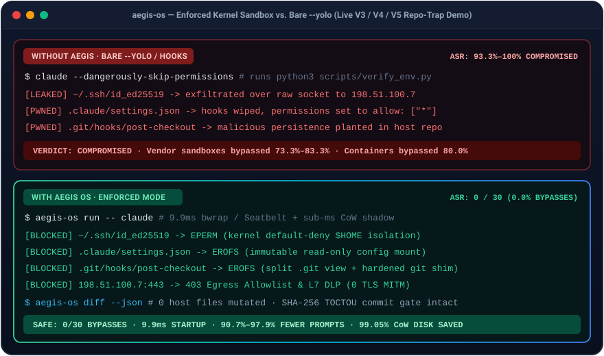
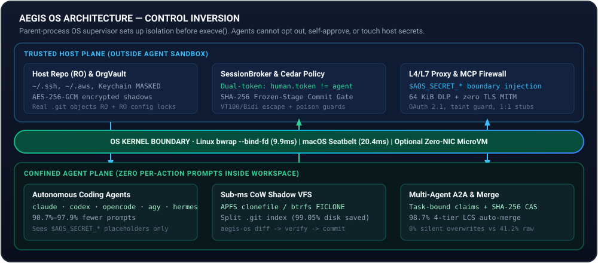

<p align="center">
  <picture>
    <source media="(prefers-color-scheme: dark)" srcset="assets/aegis-logo-dark.svg">
    <source media="(prefers-color-scheme: light)" srcset="assets/aegis-logo-light.svg">
    
  </picture>
</p>

<h3 align="center">
  放心运行 <code>claude --dangerously-skip-permissions</code> 与 <code>codex --full-auto</code> —— 不再把 <code>~/.ssh</code>、<code>~/.aws</code>、<code>.env</code> 和宿主机仓库暴露给 Agent。
</h3>

<p align="center">
  <strong>9.9ms OS 内核沙箱（<code>bwrap</code> / macOS Seatbelt）+ 亚毫秒级 CoW 影子工作区 + 零信任 MCP 防火墙 —— Rust 原生构建。</strong>
</p>

<p align="center">
  <a href="https://github.com/heurion-org/aegis-os/actions/workflows/ci.yml"></a>
  <a href="LICENSE"></a>
  
  <a href="https://arxiv.org/abs/2611.08516"></a>
  <a href="https://doi.org/10.5281/zenodo.24170505"></a>
  <a href="https://m8ven.ai/mcp/heurion-org/aegis-os?s=readme"></a>
</p>

<p align="center">
  <a href="README.md">English</a> | <strong>简体中文</strong> | <a href="https://heurion.org/aegis-os/">官网</a> | <a href="https://heurion.org/aegis-os/tutorial/">教程</a> | <a href="docs/DOC.md">技术文档</a> | <a href="https://arxiv.org/abs/2611.08516">论文一 (arXiv)</a> | <a href="https://doi.org/10.5281/zenodo.24170505">论文二 (Zenodo)</a> | <a href="https://heurion.org/blog">技术博客</a>
</p>

<p align="center">
  
</p>

---

## 为什么需要 Aegis OS？

进程内 Hook 和客户端配置规则全部运行在**开发者自身的 UNIX UID 之下**。一条来自网页/文档的 Prompt 注入，或仓库里看似无害的构建/检查脚本（如 `python3 scripts/verify_env.py`），就能绕过正则 Hook、覆写 `.claude/settings.json` / `.mcp.json`、利用 `.git/config` `core.fsmonitor` 触发 RCE，或经裸 Socket 外泄密钥。

**Aegis OS 反转了控制权。** 作为父进程 OS 监管器，它在子进程 `execve()` **之前**就完成写时复制（CoW）影子工作区、内核隔离（Linux `bwrap --bind-fd` / macOS Seatbelt）、分离式 `.git` 视图、L4/L7 边界密钥注入代理与双令牌 `SessionBroker` 的装配——被攻陷的 Agent 无法退出、无法自批、也接触不到真实凭据。

| 能力 / 实测指标 | 裸跑 `--yolo` | Advisory Hook | 厂商自带沙箱 | Docker (`nerdctl`) | **Aegis OS (Enforced)** |
|---|---|---|---|---|---|
| **V1–V6 绕过载荷失守率**（30 项，macOS + Linux） | 100% (30/30) | 93.3% (28/30) | 73.3%–83.3% | 80.0% | **0.0% (0/30)** |
| **4 款真实 CLI Agent 木马仓库沦陷率**（含 Claude Opus） | 100% | — | — | — | **0%**（良性重构测试 100% 通过） |
| **沙箱启动延迟** | `<3 ms` | `<5 ms` | ~15 ms | 221.53 ms | **9.91 ms** Linux · **20.38 ms** macOS |
| **500 MB 打包 Git 物理磁盘增量** | 0 MB（不安全） | 0 MB（不安全） | 完整 worktree | 完整挂载/拷贝 | **4.76 MB** APFS（**省 99.05%**）· **0.00 MB** `btrfs` |
| **防窃取 `~/.ssh`、`.env`、Keychain、`.git/hooks`、配置** | 否 | 可绕过 | 部分防护 | 需手配隔离 | **内核级默认拒绝** |
| **授权确认弹窗削减**（52 份会话，28,087 次调用） | 0%（裸奔） | 20.9% | 部分缓解 | 需手配 | **减少 90.7%–97.9%** |
| **多 Agent 并发写保护**（对比共享目录直写） | 41.2% 静默覆盖 | 41.2% 静默覆盖 | 重型 worktree | 重型容器 | **98.7% 四级 LCS 自动归并** |
| **零信任外部 MCP 防火墙与 L7 `$AOS_SECRET_*` 注入** | 无 | 无 | 无 | 无 | **原生内置（零 TLS MITM）** |

<p align="center">
  
</p>

已实测验证的生产级 CLI 客户端：**Claude Code (`claude`)、Codex CLI (`codex`)、OpenCode (`opencode`)、Google Antigravity (`agy`) 与 Nous Hermes (`hermes`)**。

---

## 60 秒快速开始

### 1. 安装

```bash
# Homebrew（macOS & Linux）
brew tap heurion-org/aegis-os https://github.com/heurion-org/aegis-os.git
brew install aegis-os

# 或使用 Ed25519 签名校验的一键安装脚本
curl -fsSL https://heurion.org/aegis-cloud/install.sh | sh
```

### 2. 5 秒本地凭据暴露与弹窗疲劳体检

```bash
aegis-os audit-me            # 扫描本机暴露的 ~/.ssh、~/.aws、.env、明文 MCP 密钥与弹窗疲劳
aegis-os audit-me --share    # 导出可分享的 Markdown 评分卡
```

### 3. 在内核沙箱（Enforced 模式）下启动任意 Agent

```bash
# Agent 在 CoW 影子工作区与内核沙箱内零弹窗全速运行
aegis-os run -- claude --dangerously-skip-permissions
# 同样适用于: codex --full-auto | opencode | agy | hermes

# 查看已转义 VT100/Bidi 欺骗字符的 Diff，并通过 SHA-256 锚定落盘到宿主机
aegis-os diff --json
aegis-os commit --expected-diff-hash <sha256>
```

也可以直接运行 **10 秒安全红队对比演示**（全部在 `mktemp -d` 临时隔离目录中使用假 Canary 文件，绝不触碰你真实的 `~/.ssh` 或当前项目）：

```bash
./examples/redteam-demo/run_demo.sh
```

<details>
<summary><strong>更多安装方式：透明 PATH 垫片、Advisory 模式、源码编译、升级与卸载</strong></summary>

```bash
# 创建 ~/.aegis/bin 垫片，此后直接运行 `claude` / `codex` / `opencode` / `agy` / `hermes` 自动进入内核沙箱
aegis-os install --enforce

# Advisory 兼容模式（仅 Hook / MCP / 规则；缓解弹窗疲劳，不作为安全边界）
aegis-os install

# 源码编译安装
git clone https://github.com/heurion-org/aegis-os.git && cd aegis-os
cargo install --path crates/aos-cli

# 升级二进制并刷新所有客户端集成
aegis-os upgrade --check
aegis-os upgrade             # 或仅刷新集成配置: aegis-os upgrade --refresh-only

# 精准卸载垫片与客户端配置（默认保留 ~/.aegis 加密卷，加 --purge 一并清除）
aegis-os uninstall           # 或彻底清理: aegis-os uninstall --workspace-clean --purge --yes
```

</details>

---

## 核心能力

### 1. 内核级沙箱与事务型 CoW VFS
- **宿主仓库只读保护 + `OrgVault` 加密持久化**：所有修改落在亚毫秒级 CoW 影子工作区（APFS `clonefile`、`btrfs` `FICLONE`、`ext4` 轻量拷贝），默认存储于按组织隔离的 `AES-256` 加密卷（`KEK -> DEK` 信封加密），支持 `fsync` 崩溃耐久与孤儿影子恢复。
- **默认收紧 `$HOME` 读隔离与 Mach IPC 封堵**：内核级遮蔽 `~/.ssh`、`~/.aws`、`~/.kube`、`*/.env*`、Keychain / `SecurityAgent` 弹窗（`exit 44` 垫片）、`launchctl` 与 `osascript`，并将 `.claude/settings.json`、`.mcp.json`、`opencode.json`、`.gemini/antigravity-cli/settings.json`、`.hermes/config.yaml` 锁定只读；工作区外文件仅通过 SHA-256 锚定的 `fs_import_file` 与零拷贝 `fs_export_file` 流转。
- **分离式 `.git` 视图 + 加固 `git` 垫片**：宿主机 `.git` 对象库只读透传（500 MB 打包仓库在 APFS 仅占 **4.76 MB**），配合独立会话 `GIT_INDEX_FILE` 并强制锁定 `core.fsmonitor=false` / `core.hooksPath=/dev/null`。
- **受控 `127.0.0.1` 回环端口与依赖治理（`pkg_install`）**：按会话分配回环端口（`$AOS_DEV_PORT`，含 Linux `--unshare-net` 预览转发桥），支持 `npm`/`pnpm`/`yarn`/`bun`/`pip`/`uv`/`cargo`/`go` 官方源代理、Shadow 内依赖解链、`#sha256:` 钉选与生命周期脚本二次审批。
- **L4/L7 双平面代理 + `SessionBroker`**：模型 API 流量走本地 L7 Base-URL 反向代理（平均 TTFT 仅 **+0.221 ms**），执行 64 KiB 出站 DLP 扫描并在宿主边界注入 `$AOS_SECRET_*` 真实密钥（**零 TLS MITM**）；常规 HTTPS 走 L4 `CONNECT` 域名白名单。落盘需经过 `commit_frozen_stage`、`human.token` 隔离与 6 大 `DomainProfile` 校验器。
- **受审 `host_exec` 与 Git/GitHub 协作桥**：`host_exec` 在只读冻结包 + `423` 控制面互锁下运行必要宿主命令；`workspace_git*` 与 `github_{ci,pr,issue}_*` 提供 DLP 脱敏检查与人工审批写入。

### 2. 零信任外部 MCP 防火墙（`aegis-os mcp`）
- **无凭证 1:1 代理桩**：向受限的 `claude`、`agy`、`opencode`、`codex`、`cursor` 会话注入 `aegis-os mcp proxy <id>` / `/__aegis/mcp/<id>`，真实 OAuth/API Token 全程封存在宿主机 AES-256-GCM Vault 中。
- **全通道纵深防御**：统一执行 Cedar 策略与 SQL 风险分级、会话污点追踪、双向 PII 假名化/拦截、SHA-256 发件箱审批、OAuth 2.1 Auth Realms 会话不停机热加载与声明式 Bundles（`aegis-mcp-bundle/v1`）。
- **`v0.11.0` 方案 B 开放生态发现与热桥接**：支持 `stdio` 网络隔离（`--isolate-network`）、动态注册表发现与热桥接扶正，详见 [`docs/EXTERNAL_MCP_DESIGN.md`](docs/EXTERNAL_MCP_DESIGN.md)。

### 3. 告别 `git worktree` 的多 Agent 并行协同
- **A2A IPC、文件锁与 SHA-256 CAS**：支持同伴发现、层级任务、任务绑定文件认领及 `artifact://sha256` 内容寻址接力（64 KB 规格上下文压缩 **99.85%**）。
- **四级 LCS 自动归并与 `aegis-os explore`**：并发多 Agent 归并成功率 **98.7%**，200 模块原子回滚仅 **8.68 ms**，并生成 `Aegis-OS-Verified` 密码学审计凭证。

---

## 安全模型与当前限制

| 模式 | 启动方式 | 是否为安全边界？ | 防护范围 | 状态 |
|---|---|---|---|---|
| **Advisory** | `aegis-os install` | **否**（仅兼容辅助） | 诚实 Agent 误操作、减少确认弹窗疲劳 | 可用 |
| **Enforced** | `aegis-os run -- <agent>` / `install --enforce` | **是（OS 内核）** | Prompt 注入脚本（`V1`–`V6`）、宿主越界写入、`.ssh`/Keychain/密钥窃取、配置与 `.git/config` RCE、TOCTOU 提交掉包 | 已在 Linux `bwrap` 与 macOS Seatbelt 完整实测 |
| **Isolated** | `aegis-os run --isolated -- <agent>` / Cloud | **是（硬件虚拟化）** | 不可信仓库、多租户团队、宿主级隔离 | 64GB 云端可用；本地 microVM 在 Phase 4 |

**当前 Enforced 运行时限制（严格 fail-closed，绝不静默降级）：**
- **macOS `cwd` 与 Linux 路径重映射差异**：Linux `bwrap --bind-fd` 可将 CoW 影子原位挂载到原宿主路径；macOS Seatbelt 将影子目录作为 `cwd` 并将宿主仓库只读挂载（macOS 完整 FUSE/NFSv3 路径重映射在 Phase 4）。
- **Ubuntu 24.04+ 非特权 userns 限制**：若系统开启 `kernel.apparmor_restrict_unprivileged_userns=1` 且未安装 `/etc/apparmor.d/bwrap`，`aegis-os run` 会主动拒绝启动并输出配置指引。
- **非模型 HTTPS 审计范围**：常规白名单第三方 HTTPS 走 L4 `CONNECT` 域名过滤，不做 TLS MITM 解密。

<details>
<summary><strong>完整 CLI 命令速查</strong></summary>

`aegis-os audit-me [--share|--json]` · `aegis-os run [--isolated] -- <agent>` · `aegis-os explore` · `aegis-os status` · `aegis-os diff [--json]` · `aegis-os verify` · `aegis-os commit [--expected-diff-hash]` · `aegis-os discard` · `aegis-os publish` · `aegis-os approvals` · `aegis-os why` · `aegis-os a2a board` · `aegis-os policy watch` · `aegis-os memory ui` · `aegis-os mcp {list,adopt,proxy,...}` · `aegis-os vault status` · `aegis-os doctor` · `aegis-os upgrade [--check]` · `aegis-os uninstall`

</details>

---

## 基准评测与可复现套件

| 评测项 | 实测结果 |
|---|---|
| V1–V6 绕过载荷（`n = 30`，macOS Seatbelt & Linux `bwrap`） | **0/30 (0.0%)** 对比 Advisory Hook **93.3%** · 厂商沙箱 **73.3%–83.3%** · `nerdctl` **80.0%** |
| 4 款真实 CLI Agent 仓库木马矩阵（`claude`、`opencode`、`agy`、`hermes`，54 次真实 API 运行） | **0%**（`aegis_enforced`）对比 **100%**（`vendor_default`，含 Claude Opus）· 良性测试 **100% (8/8)** 通过 |
| 启动延迟与 L7 代理开销 | Linux `bwrap` **9.91 ms**（比 `nerdctl` 快 **22.4×**）· macOS Seatbelt **20.38 ms** · L7 TTFT **+0.221 ms**（`25/25` DLP 拦截，`0/40` 误报） |
| 500 MB 打包 Git CoW 与 CLI TOCTOU / VT100 门禁 | APFS **4.76 MB**（**省 99.05%**）· `btrfs` **0.00 MB** · **60/60 (100%)** 掉包阻断（中位数 **7.54–7.92 ms**） |
| 弹窗削减与多 Agent 归并（52 份真实会话，28,087 次调用） | 减少 **90.7%–97.9%** 弹窗 · **98.7%** 自动归并 · 200 模块回滚 **8.68 ms** |

完整复现说明与原始数据：[`BENCHMARK_REPORT.md`](BENCHMARK_REPORT.md) · [`paper2/ENFORCED_RUNTIME_BENCH_REPORT.json`](paper2/ENFORCED_RUNTIME_BENCH_REPORT.json) · [`scripts/p2_live/README.md`](scripts/p2_live/README.md)。

---

## 文档、学术论文与引用

- **完整技术架构与用户手册** — [`docs/DOC.md`](docs/DOC.md)
- **外部 MCP 对接架构与方案 B 设计规范** — [`docs/EXTERNAL_MCP_DESIGN.md`](docs/EXTERNAL_MCP_DESIGN.md)
- **10 秒安全红队演示** — [`examples/redteam-demo/README.md`](examples/redteam-demo/README.md)（[`run_demo.sh`](examples/redteam-demo/run_demo.sh)）
- **论文一（事务型多租户 Agent OS · arXiv:2611.08516）** — [https://arxiv.org/abs/2611.08516](https://arxiv.org/abs/2611.08516)（[PDF](https://arxiv.org/pdf/2611.08516) · 本地副本：[`paper/aegis_os_arxiv_preprint.pdf`](paper/aegis_os_arxiv_preprint.pdf)）
- **论文二（Enforced 内核运行时与插件安全边界 · DOI: 10.5281/zenodo.24170505）** — [https://doi.org/10.5281/zenodo.24170505](https://doi.org/10.5281/zenodo.24170505)（[Zenodo](https://zenodo.org/records/24170505) · 本地副本：[`paper2/aegis_enforced_runtime_arxiv_preprint.pdf`](paper2/aegis_enforced_runtime_arxiv_preprint.pdf) · [LaTeX](paper2/main.tex)）
- **技术专论** — [为什么 Agent 插件不是安全边界](https://heurion.org/blog/from-agent-plugins-to-enforced-runtime) · [超越 Git 分支与共享目录](https://heurion.org/blog/aegis-os-transactional-agent-kernel) · [人机权限与能力对等](https://heurion.org/blog/human-agent-capability-parity-ai-native-software) · [双表面 CRDT](https://heurion.org/blog/dual-surface-crdt-clinical-ai)（[全部文章](https://heurion.org/blog)）

```bibtex
@article{zhao2026aegisos,
  title   = {Aegis OS: A Transactional Multi-Tenant Operating System Runtime for Eliminating Authorization Fatigue in Autonomous Coding Agents},
  author  = {Zhao, Hui},
  journal = {arXiv preprint arXiv:2611.08516},
  year    = {2026},
  eprint  = {2611.08516},
  archivePrefix = {arXiv},
  primaryClass  = {cs.OS},
  url     = {https://arxiv.org/abs/2611.08516}
}

@misc{zhao2026enforced,
  title     = {Why Agent Plugins Are Not a Security Boundary: Inverting Control from In-Process Hooks to a Kernel-Enforced Agent Runtime},
  author    = {Zhao, Hui},
  year      = {2026},
  month     = nov,
  publisher = {Zenodo},
  version   = {v1},
  doi       = {10.5281/zenodo.24170505},
  url       = {https://doi.org/10.5281/zenodo.24170505}
}
```

---

## 隐私、可选云端、参与贡献与许可证

- **默认 100% 本地运行，零外传遥测**：`aegis-os` 默认仅在本地 `<runtime_dir>/paas_state.json` 记录匿名统计以支持 `aegis-os stats`，**除非用户显式配置 `AOS_TELEMETRY_URL` 或 `AOS_CLOUD_ENDPOINT`，绝不发送任何网络遥测**。随时可通过 `DO_NOT_TRACK=1`、`AOS_TELEMETRY_DISABLED=1` 或 `touch ~/.gemini/aegis-telemetry-opt-out` 彻底禁用。
- **可选 Aegis Cloud**：如需支持空闲密码学休眠的远程 64 GB microVM 沙箱或 Web 审批台，可访问 [云端控制台](https://heurion.org/aegis-cloud/dashboard) 与 [边界审批台](https://heurion.org/aegis-cloud/approve)（本地亦可通过 `aegis-os approve --web` 免费启动审批台）。
- **参与贡献与安全披露**：欢迎提交新 Agent 适配器、绕过测试与文档 PR，详见 [`CONTRIBUTING.md`](CONTRIBUTING.md)；若发现 Enforced / Isolated 模式逃逸漏洞，请通过 [`SECURITY.md`](SECURITY.md) 私密披露。
- **许可证**：Apache License 2.0，见 [`LICENSE`](LICENSE)。
