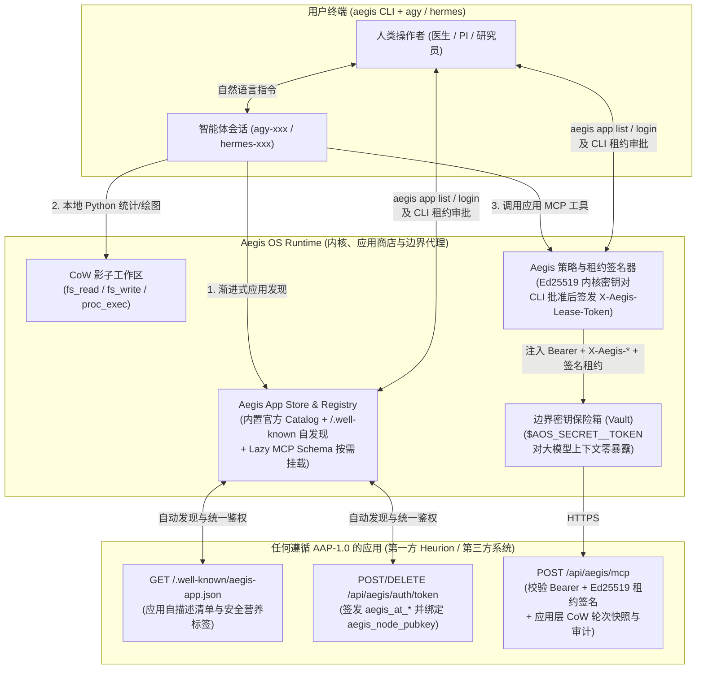
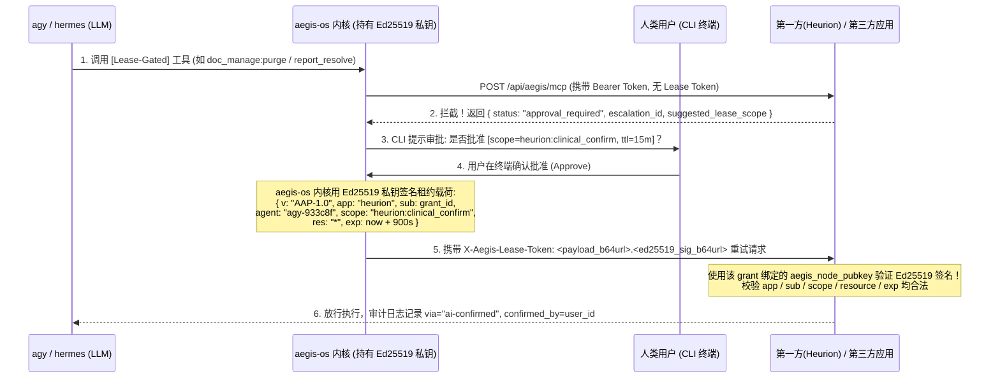

# Aegis Application Protocol (`AAP-1.0`) 与 Heurion 2.0 接入实施方案

本文档定义 **Aegis OS 应用接入协议（`AAP-1.0`）**、**Aegis App Store 发现机制**、**第一方与第三方统一鉴权与 Ed25519 加密租约（Lease）验证标准（SOP）**，以及 **Heurion 2.0 作为 `aegis-os` 首个第一方应用（First-Party Reference Implementation）的工程落地方案**。

---

## 1. 架构愿景：第一方与第三方完全同构（Dogfooding 原则）

当用户在终端通过 `agy` 或 `hermes` CLI 智能体工作时，底层运行在 **`aegis-os`（Agent 操作系统内核与安全运行时）** 之上：
- **`aegis-os` 内核层**：负责提供写时复制影子工作区（CoW Shadow Workspace）、OS 内核级沙箱命令执行（`proc_exec`）、多智能体通信与内容寻址总线（`ipc_*` / `org_artifact_*`）、出站密钥边界注入（Vault），以及 `[Zero-Prompt]` 与 `[Lease-Gated]` 策略引擎。
- **领域应用层（First-Party & Third-Party Apps）**：Heurion 2.0 作为临床科研与多智能体论文协作平台，以原生应用（App）形态挂载到 `aegis-os` 上。

> **核心设计准则（零私有后门）**：
> 第一方应用（Heurion 2.0）**绝不走任何硬编码私有后门**，而是严格实现本规范定义的 **`AAP-1.0` 标准协议**。无论是第一方的 `heurion`，还是未来接入的任何第三方系统（如医院 HIS、实验室 LIMS、机构内部数据平台），在用户 CLI 体验、Agent 发现机制、Token 格式、请求头边界注入、以及高危操作 Ed25519 租约验签上**100% 保持一致**。



---

## 2. `aegis-os` 应用商店（App Store）与渐进式发现架构

### 2.1 人类用户视角：CLI 应用商店体验 (`aegis app`)

`aegis-os` 采用 **“内置官方精选目录（Built-in Catalog） + 去中心化 `.well-known` 自发现”** 的双层注册表设计。用户安装完 `aegis-os` 后，无需手写 JSON 配置文件或手动管理环境变量，直接通过 `aegis app` 命令管理所有第一方与第三方应用：

```text
$ aegis app list

Aegis OS App Store & Connected Applications:
──────────────────────────────────────────────────────────────────────────────────────────
APP ID           TRUST        STATUS                  SUMMARY
heurion          1st-party    ● Connected (qiandong)  Heurion 2.0 临床科研、患者时间线与多智能体论文工作台
ironmac          1st-party    ● Connected (local)     硬件级密钥保险箱、链上交易解码与系统安全审计
crypto-strategy  1st-party    ○ Available             周期温度计、资产稀释审计与跨链 RWA 意图引擎
ustc-his         3rd-party    ○ Available (Intranet)  医院内网 HIS 检验与影像归档接口
──────────────────────────────────────────────────────────────────────────────────────────
Commands:
  aegis app info <app_id>      查看应用提供的工具域、安全分级（隐私营养标签）与服务端地址
  aegis app login <app_id>     统一登录授权并绑定本地 aegis-os Ed25519 公钥
  aegis app logout <app_id>    吊销服务端凭证并清理本地 Vault
  aegis app add <https://url>  通过 /.well-known/aegis-app.json 接入任意第三方或私有部署应用
```

### 2.2 智能体视角：三级渐进式发现（防止 Context Window 爆炸）

如果应用商店中有 20 个应用、总计近千个 MCP 工具，将所有 JSON Schema 全量塞入 `agy` / `hermes` 的初始上下文会导致严重的 Token 膨胀与推理退化。因此 `aegis-os` 采用**三级渐进式挂载（Progressive Discovery & Lazy Mounting）**：

1. **Level 1 — 系统提示词微型目录（~200 Tokens）**：
   `aegis-os` 启动 `agy` / `hermes` 时，仅在系统上下文中注入一张极简摘要表（每个应用仅占 1 行：`app_id` + 连接状态 `connected | available_not_connected` + 一句话能力标签）。
2. **Level 2 — 未授权时的对话内主动引导**：
   当用户的自然语言任务涉及某个尚未登录的应用（例如 `heurion` 状态为 `available_not_connected`）时，Agent 通过 Level 1 目录感知到该应用的存在，主动在 CLI 中引导用户完成授权（或提示执行 `aegis app login heurion`）。
3. **Level 3 — 按需懒加载工具 Schema（Lazy MCP Mounting）**：
   应用下数十个工具的详细参数 Schema 缓存在本地 `<appDataDir>/mcp/<app_id>/` 目录中；仅当 Agent 在当前任务中实际需要使用该领域工具时，才按需读取对应工具的 Schema 并通过 `call_mcp_tool` 调用。

### 2.3 标准自发现清单规范：`GET /.well-known/aegis-app.json`

任何接入 `aegis-os` 的项目（包括第一方 `heurion`）必须在根路径下暴露 `GET /.well-known/aegis-app.json`：

```json
{
  "schema_version": "AAP-1.0",
  "app_id": "heurion",
  "name": "Heurion 2.0 Clinical & Research Platform",
  "version": "2.1.0",
  "publisher": "Heurion Research Lab",
  "trust_tier": "first_party",
  "categories": ["clinical-research", "biomedical", "manuscript-collab"],
  "summary": "Clinical cohort analysis, de-identified EHR/imaging timelines, PubMed literature verification, and real-time Yjs manuscript/slide authoring.",
  "endpoints": {
    "mcp_http": "/api/aegis/mcp",
    "auth_token": "/api/aegis/auth/token",
    "auth_grants": "/api/aegis/auth/grants",
    "lease_approve": "/api/aegis/leases/approve",
    "health": "/api/health"
  },
  "auth": {
    "type": "aegis_user_bound_token",
    "token_prefix": "aegis_at_heurion.",
    "secret_env_key": "AOS_SECRET_HEURION_TOKEN",
    "requires_node_pubkey": "ed25519",
    "required_headers": [
      "Authorization",
      "X-Aegis-Protocol",
      "X-Aegis-Org-Id",
      "X-Aegis-Agent-Id",
      "X-Aegis-Turn-Id"
    ],
    "lease_header": "X-Aegis-Lease-Token"
  },
  "capabilities_preview": [
    {
      "domain": "manuscript_and_slides",
      "description": "ProseMirror/Yjs .docx & .pptx authoring, tables, figures, comments, and selective turn rollback",
      "default_tier": "zero_prompt_cow_write"
    },
    {
      "domain": "literature_and_verification",
      "description": "PubMed, Crossref, OpenAlex search and manuscript citation/claim verification",
      "default_tier": "zero_prompt_read"
    },
    {
      "domain": "clinical_ehr_and_cohorts",
      "description": "PHI-redacted patient timelines, lab series, RECIST imaging analysis, and cohort dataset export",
      "default_tier": "zero_prompt_cow_write"
    },
    {
      "domain": "governance_and_irreversible_actions",
      "description": "Permanent document/dataset purge, clinical record confirmation, break-glass PHI access, tenant/platform admin",
      "default_tier": "lease_gated"
    }
  ]
}
```

---

## 3. 第一方与第三方统一鉴权及加密租约协议 (`AAP-Auth`)

### 3.1 统一 CLI 登录与节点公钥绑定 (`POST /api/aegis/auth/token`)

无论是第一方应用还是第三方应用，用户统一执行 `aegis app login <app_id>`：
1. **用户身份鉴别**：支持 CLI 交互式凭证（账号 + 密码 / OTP）或企业/医院 SSO 的 Device Code 授权流。
2. **注册 `aegis-os` 节点公钥（`aegis_node_pubkey`）**：
   `aegis-os` 守护进程在本地生成一对受操作系统保护的 **Ed25519 非对称密钥对**（私钥仅驻留在 `aegis-os` 内核进程与系统 Keychain 中，Agent 大模型与沙箱子进程无法访问），并在登录请求中将公钥 `aegis_node_pubkey` 发送给应用服务端。
3. **签发绑定人类用户的 Agent 凭证**：
   - 应用服务端验证用户状态正常（`user.status === 'active'`），将 `(grant_id, user_id, aegis_node_pubkey, token_hash, user_token_version)` 写入数据库，并返回标准格式凭证：
     ```text
     aegis_at_<app_id>.<grant_id>.<random_secret>
     ```
     （例如：`aegis_at_heurion.g_9f82c1.<secret>`）
   - **人机同权（Human–Agent Permission Symmetry）**：该凭证在应用服务端直接解析为该人类用户本人（`Principal = User`, `Actor = Agent`），自动继承该用户在机构、课题组、患者档案与文档上的全部 RBAC 权限边界。

### 3.2 边界密钥零泄漏注入（Zero-Leakage Boundary Injection）

`aegis-os` 将获取到的 Token 存入本地安全保险箱（映射为 `$AOS_SECRET_<APP_ID>_TOKEN`）。
- **大模型上下文零接触**：`agy` 或 `hermes` 的 Prompt 上下文中永远不会出现明文 Token，彻底消除 Prompt Injection 窃取用户长效凭证的风险。
- **统一边界请求头**：当 Agent 调用应用的 MCP 接口时，由 `aegis-os` 在出站边界自动注入：
  ```http
  Authorization: Bearer aegis_at_heurion.<grant_id>.<secret>
  X-Aegis-Protocol: AAP-1.0
  X-Aegis-Org-Id: org_ustc_lab
  X-Aegis-Agent-Id: agy-933c8f
  X-Aegis-Turn-Id: turn-20261023-0042
  X-Aegis-Lease-Token: <optional-ed25519-signed-lease-token>
  ```

### 3.3 `[Lease-Gated]` 高危操作的 Ed25519 加密租约验证

当 Agent 调用高危或不可逆操作（Tier 2 `lease_gated`）时，**第一方与第三方应用如何零信任地确认“这次操作确实经过了人类用户在 CLI 中批准”，而不是 Agent 自己伪造请求重发？**



- **不可伪造性**：由于 Ed25519 私钥由 `aegis-os` 内核独占，Agent 无法自行签发合法的 `X-Aegis-Lease-Token`。任何伪造签名、篡改 `scope` 或已过期的租约都会在应用服务端被直接拒绝（`403 Forbidden`）。
- **兼容服务端直接审批**：除校验 Ed25519 签名头外，应用服务端同时提供 `POST /api/aegis/leases/approve` 接口（要求人类用户会话或显式审批调用），在服务端落库一条短时效 `agent_leases` 记录，兼顾未开启硬件密钥对的轻量运行环境。

---

## 4. 第三方与第一方项目接入 `aegis-os` 标准作业程序（4-Step SOP）

任何项目只需按照以下 **4 步 SOP** 即可接入 `aegis-os` 成为原生应用：

### Step 1：将业务能力划分为 `AAP-1.0` 三级安全策略

| 策略等级 | CLI 交互体验 | 应用服务端强制要求 | Heurion 2.0 对应工具域 |
|---|---|---|---|
| **Tier 0: `zero_prompt_read`** | **免打扰直接执行** | 返回给 Agent 前必须完成敏感信息（PHI/PII/密钥）脱敏 | `doc_read`, `patient_read`（经双阶段本地 PHI 漏斗脱敏）, `pubmed_search`, `dataset_describe`, `study_read` |
| **Tier 1: `zero_prompt_cow_write`** | **免打扰直接执行**（覆盖 95% 日常高频创作与分析） | 必须记录 `(X-Aegis-Agent-Id, X-Aegis-Turn-Id)`，并在写操作前自动保存**应用层写时复制快照（Turn Snapshot）**，提供按轮次精准回滚工具 (`*_revert_turn`) | `doc_edit`, `deck_edit`, `insert_citation`, `asset_upload`, `patient_record_propose`, `imaging_analyze` + **`doc_revert_turn`** |
| **Tier 2: `lease_gated`** | **触发 CLI 租约审批**（覆盖 5% 不可逆或越界操作） | 无合法 `X-Aegis-Lease-Token` 时严禁执行，必须返回标准 `approval_required` 载荷；验签通过后方可执行并记入确认审计流水 | `doc_manage(purge)`, `dataset_manage(delete)`, `lab_resolve`, `report_resolve`, `patient_break_glass`, `tenant_admin`, `platform_admin` |

### Step 2：暴露应用自描述清单 `GET /.well-known/aegis-app.json`
按 2.3 节 Schema 声明应用元数据、端点路径、鉴权配置与能力分级预览。

### Step 3：暴露统一鉴权端点 `POST` & `DELETE /api/aegis/auth/token`
1. `POST /api/aegis/auth/token`：验证用户凭证，保存 `aegis_node_pubkey`，签发 `aegis_at_<app_id>.<grant_id>.<secret>`。
2. `DELETE /api/aegis/auth/token`：吊销当前 Token（或指定 `grant_id`）。
3. **即时熔断保障**：当用户在网页端修改密码、点击“退出所有设备（`logout_everywhere`）”或账号被管理员禁用时，通过比对 `user.token_version === grant.user_token_version` 与 `user.status === 'active'`，所有已签发的 Agent Token 立即自动失效。

### Step 4：暴露受控 MCP 网关 `POST /api/aegis/mcp`
1. 校验 `Authorization: Bearer aegis_at_*`，还原真实人类用户上下文 `ctx.user`。
2. 提取 `X-Aegis-Agent-Id` 与 `X-Aegis-Turn-Id`，为每个智能体维护独立的轮次快照（支持多智能体并发协作时按指定 Agent 轮次精准撤回，互不干扰）。
3. 对 Tier 2 (`lease_gated`) 工具强制执行 Ed25519 `X-Aegis-Lease-Token` 验签或服务端有效租约核验。

---

## 5. Heurion 2.0 第一方参考实现改造计划 (Implementation Plan)

为使 Heurion 2.0 的实现具备高内聚性（后续可直接提取为通用 `@aegis-os/app-sdk`），我们将 `AAP-1.0` 协议层集中实现在 `apps/platform/src/aegis/` 目录下：

### 5.1 数据库 Schema 扩展 (`apps/platform/src/store/db.ts`)
1. 新增 **`agent_grants`** 表：
   - 字段：`id`, `app_id` (`'heurion'`), `user_id`, `name`, `token_hash` (SHA-256), `token_prefix`, `aegis_node_pubkey` (Ed25519 公钥), `tool_scope` (`'full' | 'authoring' | 'clinical_read'`), `permissions`, `doc_ids`, `write_mode`, `user_token_version`, `created_at`, `expires_at`, `last_used_at`, `last_agent_id`, `revoked_at`。
2. 新增 **`agent_escalations`** 与 **`agent_leases`** 表：
   - 记录高危操作触发的待审批请求（`esc-heurion-<id>`）及已批准的作用域租约（`grant_id`, `user_id`, `agent_id`, `scope_pattern`, `resource_pattern`, `expires_at_ms`）。

### 5.2 `AAP-1.0` 核心协议模块 (`apps/platform/src/aegis/`)
1. **[NEW] `apps/platform/src/aegis/manifest.ts`**：
   - 定义 `AegisAppManifest` 类型并生成 Heurion 2.0 的 `/.well-known/aegis-app.json` 响应。
2. **[NEW] `apps/platform/src/aegis/auth.ts`**：
   - 实现 `AegisAuthService`：
     - 签发与常数时间校验（`timingSafeEqual`）`aegis_at_heurion.<grantId>.<secret>`（兼容 `h1_agt.` 前缀）。
     - 强校验生产环境用户有效性（`user.status === 'active'`、所属租户激活、`user.token_version === grant.user_token_version`）。
     - 使用 Node.js 原生 `crypto.verify(null, payloadBytes, publicKey, sigBytes)` 验证 `X-Aegis-Lease-Token` 的 Ed25519 签名、有效期（`exp`）、目标应用（`app === 'heurion'`）、授权对象（`sub === grant.id`）及作用域通配符匹配（`scope` / `resource`）。

### 5.3 受控 MCP 网关与 CoW 沙箱桥接 (`apps/platform/src/mcp/server.ts` & `admin-tools.ts`)
1. **挂载受控外部网关 `handleAegisMcp`（路径：`POST /api/aegis/mcp` 及别名 `/api/mcp`）**：
   - 保持内部回环接口 `/mcp` 与 `/llm/v1` 严格限制在 `127.0.0.1` / `::1`。
   - `/api/aegis/mcp` 强制要求 `Bearer aegis_at_heurion.*` 认证，并将 `(grant_id, X-Aegis-Agent-Id, X-Aegis-Turn-Id)` 注入 `TurnRegistry`。
   - **应用层 CoW 自动快照**：外部 Agent 首次修改某篇文档时，自动向 `turn_bases` 写入修改前的 Yjs 状态快照。
   - **Tier 2 `[Lease-Gated]` 拦截与放行**：
     - 当 Agent 调用 `CONFIRM_ROUTES` 中的高危动作（如 `doc_manage:purge`、`report_resolve`、`tenant_admin`、`platform_admin`、`patient_admin:break_glass`）时：
     - 若携带了验签通过的 `X-Aegis-Lease-Token`（或存在有效服务端租约），则直接在网关层以 `via: 'ai-confirmed'`、`confirmedBy: userId` 放行执行；
     - 若未携带有效租约，则立即返回符合 `AAP-1.0` 规范的 `{ status: 'approval_required', escalation_id: 'esc-heurion-...', reason, suggested_lease_scope }` 结构化响应。
2. **新增 CLI 回滚与 CoW 工作区桥接能力**：
   - 新增 MCP 工具 **`doc_revert_turn`**：支持 CLI Agent 按指定 `turn_id`（或当前 `X-Aegis-Agent-Id` 在该文档上的最近一轮修改）执行精准 CRDT 逆运算回滚，不破坏其他协作者或并行子智能体的修改。
   - 增强 **`asset_upload`** 与 **`report_upload`**：除本地路径外，新增支持 `data_base64` + `filename` 参数，使运行在 `aegis-os` 隔离 CoW 沙箱中的 Agent 在通过 `proc_exec` 生成统计图表（PNG/PDF）后，可直接通过 HTTP MCP 将图表字节流连同 Python 脚本代码溯源（`AssetProvenance`）一并上传并插入论文或幻灯片。

### 5.4 HTTP 路由挂载 (`apps/platform/src/http/api.ts` & `apps/platform/src/index.ts`)
- `GET /.well-known/aegis-app.json`：公开自发现清单。
- `POST /api/aegis/auth/token`：支持使用账号密码（或已登录 Cookie 会话）签发 `aegis_at_heurion.*` 并绑定 `aegis_node_pubkey`。
- `GET /api/aegis/auth/grants` & `DELETE /api/aegis/auth/token`：查询与吊销已授权的 `aegis-os` 节点凭证。
- `POST /api/aegis/leases/approve`：批准指定的 `escalation_id` 并签发短时效租约。
- `POST /api/aegis/mcp`（及 `/api/mcp`）：统一受控 MCP 端点。

---

## 6. 自动化测试与验证矩阵 (`apps/platform/tests/aegis-app.test.ts`)

| 测试维度 | 验证内容 | 预期结果 |
|---|---|---|
| **1. App Store 自发现** | 请求 `GET /.well-known/aegis-app.json` | 返回合法的 `AAP-1.0` 清单，包含端点路径、Ed25519 鉴权声明与 4 大能力域分级标签 |
| **2. 统一鉴权与人机同权** | 调用 `POST /api/aegis/auth/token` 签发 Token 并注册 Ed25519 公钥 | 正常医生账号成功签发 `aegis_at_heurion.*`；禁用账号、错误密码、跨租户越权访问均被拦截；执行 `logout_everywhere` 或 `DELETE /api/aegis/auth/token` 后 Token 立即失效 |
| **3. `[Zero-Prompt]` 多智能体协同与按轮次回滚** | 两个 `aegis-os` 智能体（`X-Aegis-Agent-Id: agy-writer` 与 `agy-biostat`）并发编辑同一篇 `.docx` | 免确认直接写入成功；对 `agy-writer` 调用 `doc_revert_turn` 后，仅撤回 `agy-writer` 的段落修改，`agy-biostat` 的修改完好保留 |
| **4. `[Lease-Gated]` Ed25519 加密租约验签** | 调用高危工具（如 `doc_manage:purge` 或 `tenant_admin:update_settings`） | 无租约时返回 `status: 'approval_required'` 与 `escalation_id`；使用非绑定私钥或过期时间戳伪造的 `X-Aegis-Lease-Token` 返回 `403`；使用绑定私钥签发的合法 `X-Aegis-Lease-Token` 成功执行并记录 `via: 'ai-confirmed'` |
| **5. CoW 沙箱 Base64 资产与代码溯源桥接** | 通过 `/api/aegis/mcp` 调用 `asset_upload(data_base64, code, dataset_id)` | 图片成功落盘并绑定 `AssetProvenance`（可通过 `asset_provenance` 查验生成该图的 Python 代码与数据集版本） |
