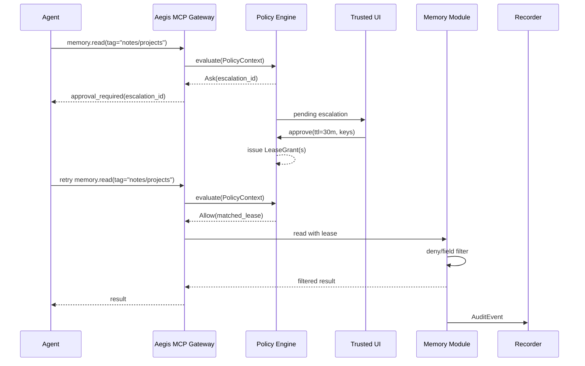

# UOMP → Aegis OS 记忆同意映射

> **状态：设计稿（2026-10）。** 本文定义 UOMP 协议语义如何落到 Aegis OS 的 policy、lease、approval、sandbox 与 audit 机制上。它是品牌合并后的第一份技术映射，不改变现有 UOMP 或 Aegis 代码。

## 1. 目的

UOMP 定义 **Agent 如何请求个人记忆**；Aegis OS 定义 **运行时如何强制执行同意**。

本文回答四个问题：

1. UOMP 的 `Session`、`Scope`、`CapabilityToken` 分别对应 Aegis 的什么？
2. `uom.json` 如何进入 Aegis 的 manifest / policy 模型？
3. UOMP Memory Guard 的职责如何拆分到 Aegis 的 gateway、policy、memory module 和 recorder？
4. 哪些语义是 Aegis 当前模型表达不了的，需要补什么？

## 2. 分层关系

```text
┌──────────────────────────────────────────────────────────────┐
│ UOMP · 开放协议                                               │
│ scope · consent · session · capability token · audit         │
└──────────────────────────────┬───────────────────────────────┘
                               │  reference implementation
                               ▼
┌──────────────────────────────────────────────────────────────┐
│ Aegis OS · 参考运行时                                         │
│ sandbox · policy · lease · escalation · trusted approval     │
│ gateway · recorder · memory data plane                       │
└──────────────────────────────────────────────────────────────┘
```

原则：

- **UOMP 保持协议中立。** 不把 Aegis 的内部类型写进规范。
- **Aegis 是参考实现，不是唯一实现。** 映射通过 adapter 完成，避免把 UOMP 绑死在 Rust runtime 上。
- **不做 big-bang 代码合并。** 先映射语义，再替换执行层。

## 3. 概念映射总表

| UOMP | Aegis OS | 说明 |
|---|---|---|
| `Session` | Consent envelope + 1..N `LeaseGrant` | 一个 Session 可能包含多个 tag/key，因此对应一组 lease |
| `ConsentRequest` | `PendingEscalation` | `request_id` ↔ `escalation_id` |
| `CapabilityToken` | `LeaseGrant` + signed lease token | JWT claims 映射为 lease 约束 |
| `ScopeAction.read` | `action = memory.read` | `list` / `search` / `read` 都归入读操作 |
| `ScopeAction.write` | `action = memory.write` | 写入、更新 |
| `read.tags[]` | `resource = memory:tag:<tag>` | 每个 tag 一条 lease |
| `read.keys[]` | `resource = memory:key:<key>` | 每个 key 一条 lease |
| `denyTags[]` / `denyKeys[]` | `PolicyDecision::Deny` + memory filter | lease pattern 无法表达 deny，必须由 memory module 二次校验 |
| `allowedFields[]` / `fields` | `details.allowed_fields` + projection | 字段级过滤在 memory module 执行 |
| `purposes` | `details.purposes` + policy condition | 可选，先记录不强制执行 |
| `sensitivity` | R3 / R4 路由 | high 默认 R4，medium 可配置，low 可 R3 |
| `Memory Guard` | Gateway + Policy + Memory module | 职责拆分，不是一一对应 |
| `AuditLogEntry` | `AuditEvent` | UOMP 字段放入 `details` |
| `uom.json` | Aegis manifest 的 `memory` profile | 内嵌，不维护两份 manifest |
| `uomp setup` | Aegis onboarding / app registration | 用户入口统一到 Aegis |
| `uomp approve` | Trusted UI / Aegis approval console | Agent 不能自己批准自己 |

## 4. 数据模型映射

### 4.1 Session ↔ PendingEscalation + LeaseGrant

UOMP `Session`：

```ts
interface Session {
  sessionId: string;
  agentId: string;
  agentName?: string;
  status: 'created' | 'active' | 'closed' | 'expired' | 'revoked';
  createdAt: string;
  expiresAt: string;
  grantedScopes?: Scopes;
  requestedScopes: Scopes;
  tokenHash?: string;
}
```

Aegis 没有单个 `Session` 类型，等价语义由两个对象承载：

- `PendingEscalation`：等待用户同意的请求。
- `LeaseGrant`：同意后签发的限时权限。

状态映射：

| UOMP Session 状态 | Aegis 状态 |
|---|---|
| `created` | `PendingEscalation { status: Pending }` |
| `active` | 一个或多个 `LeaseGrant` 生效 |
| `closed` | lease 到期或被移除 |
| `expired` | lease 到期；escalation 过期 |
| `revoked` | lease 被撤销；写入审计 |

**一个 Session 对应多个 lease。** 例如：

```text
Session sess_abc
  read.tags = ["notes/projects", "profile"]
  read.keys = ["note.projects.plan"]

→ lease-1: memory.read / memory:tag:notes/projects
→ lease-2: memory.read / memory:tag:profile
→ lease-3: memory.read / memory:key:note.projects.plan
```

这样做的原因：

- `LeaseGrant` 只有单个 `action_pattern` 和 `resource_pattern`，无法表达多 tag/key。
- 每个 lease 独立过期、独立审计，撤销粒度更细。
- 与 Aegis 现有的 lease 匹配逻辑兼容。

### 4.2 ConsentRequest ↔ PendingEscalation

UOMP `ConsentRequest`：

```ts
interface ConsentRequest {
  requestId: string;
  sessionId: string;
  client?: string;
  agentId: string;
  agentName?: string;
  requestedScopes: Scopes;
  envPath?: string;
  baseUrl?: string;
  status: 'pending' | 'approved' | 'denied' | 'expired';
  createdAt: string;
  expiresAt: string;
  approvedAt?: string;
  grantedScopes?: Scopes;
}
```

Aegis `PendingEscalation`：

```rust
pub struct PendingEscalation {
    pub escalation_id: String,
    pub org_id: String,
    pub agent_id: String,
    pub action: String,
    pub target_resource: String,
    pub reason: String,
    pub suggested_lease_scope: String,
    pub status: EscalationStatus,
    pub created_at_ms: i64,
}
```

映射：

| UOMP | Aegis |
|---|---|
| `requestId` | `escalation_id` |
| `agentId` | `agent_id` |
| `requestedScopes` | `suggested_lease_scope`（JSON） |
| `status: pending` | `EscalationStatus::Pending` |
| `status: approved` | `EscalationStatus::Approved` |
| `status: denied` | `EscalationStatus::Denied` |
| `status: expired` | 需要新增 `EscalationStatus::Expired` |
| `createdAt` | `created_at_ms` |
| `expiresAt` | 需要新增 `expires_at_ms` |
| `client` / `envPath` / `baseUrl` | 放入 `details` 或新增 metadata |

**建议扩展 Aegis：**

```rust
pub enum EscalationStatus {
    Pending,
    Approved,
    Denied,
    Expired,
}

pub struct PendingEscalation {
    // existing fields...
    pub expires_at_ms: Option<i64>,
    pub details: serde_json::Value, // client, env_path, requested_scopes, ...
}
```

### 4.3 CapabilityToken ↔ LeaseGrant / signed lease token

UOMP `CapabilityToken` 是 EdDSA 签名的 JWT：

```ts
interface CapabilityTokenPayload {
  version: string;
  sessionId: string;
  agentId: string;
  issuedAt: string;
  expiresAt: string;
  scopes: Scopes;
  limits?: { maxReadQueries?: number; maxWriteQueries?: number };
  profile?: string;
  audience?: string;
  allowedEndpoints?: string[];
  allowedFields?: string[];
  aggregationOnly?: boolean;
  taskBound?: boolean;
}
```

Aegis 的服务端 lease：

```rust
pub struct LeaseGrant {
    pub lease_id: String,
    pub org_id: String,
    pub agent_id: String,
    pub action_pattern: String,
    pub resource_pattern: String,
    pub expires_at_ms: i64,
    pub granted_by: String,
}
```

映射：

| UOMP JWT claim | Aegis lease |
|---|---|
| `sessionId` | `lease_id` 的前缀或 `details.session_id` |
| `agentId` | `agent_id` |
| `expiresAt` | `expires_at_ms` |
| `scopes.read` | `action_pattern = memory.read` + resource patterns |
| `scopes.write` | `action_pattern = memory.write` + resource patterns |
| `limits.maxReadQueries` | memory module 的 quota counter |
| `limits.maxWriteQueries` | memory module 的 quota counter |
| `audience` | gateway audience check |
| `allowedFields` | `details.allowed_fields` |
| `aggregationOnly` | `details.aggregation_only` |
| `taskBound` | `details.task_bound`；完成后自动撤销 lease |

如果 Aegis 使用 Ed25519 `X-Aegis-Lease-Token`，建议 claims：

```json
{
  "app": "aegis-memory",
  "sub": "lease-7f3a",
  "agent": "claude-desktop",
  "scope": "memory.read",
  "resource": "memory:tag:notes/projects",
  "exp": 1760000000,
  "session": "sess_abc",
  "allowed_fields": ["title", "body"],
  "aggregation_only": false,
  "task_bound": false
}
```

关键点：

- Agent 只持有 lease token，不持有 approval secret。
- Token 不能自批；审批只发生在 trusted UI。
- 撤销时服务端删除/标记 lease，gateway 每次请求检查 lease 状态。

### 4.4 Scope ↔ Policy resource/action

UOMP `ScopeAction`：

```ts
interface ScopeAction {
  tags: string[];
  keys: string[];
  denyTags: string[];
  denyKeys: string[];
  allowedFields?: string[];
  fields?: Record<string, string[]>;
  purposes?: Record<string, string>;
}
```

建议的 Aegis resource 命名：

| UOMP | Aegis resource |
|---|---|
| tag | `memory:tag:<tag>` |
| key | `memory:key:<key>` |
| field | `memory:field:<key>#<field>` |
| 全部记忆 | `memory:*` |
| 某个 namespace | `memory:tag:notes/*` |

建议的 action：

| UOMP | Aegis action |
|---|---|
| `read` / `list` / `search` | `memory.read` |
| `write` / `update` | `memory.write` |
| `delete` | `memory.delete`（从 write 派生） |
| `export` | `memory.export`（未来） |

匹配规则：

- `memory:tag:notes/projects` 允许该 tag 下的所有 key。
- `memory:key:note.projects.plan` 只允许单个 key。
- `memory:tag:notes/*` 允许 `notes/` 前缀下的所有 tag。
- `memory:*` 只在用户显式批准“全部记忆”时签发。

**deny 与 field 不能只靠 lease。** Aegis `LeaseGrant` 只有正向 pattern，没有 deny list，也不理解字段。因此：

1. Policy engine 先检查显式 deny 规则（R0 / R1）。
2. Memory module 在返回数据前再次检查 `denyTags` / `denyKeys` / `allowedFields`。
3. 审计记录必须包含被 deny 的 key/tag。

推荐把 deny 检查放在 memory module，因为它需要知道数据实际属于哪些 tag、包含哪些字段。

### 4.5 AuditLogEntry ↔ AuditEvent

UOMP `AuditLogEntry`：

```ts
interface AuditLogEntry {
  id: string;
  timestamp: string;
  sessionId: string;
  agentId: string;
  action: 'read' | 'write' | 'delete' | 'query' | 'deletion_proof' | 'deletion_proof_missing';
  key?: string;
  tags?: string[];
  allowed: boolean;
  reason: string;
  requestSize?: number;
  responseSize?: number;
  queryCountRemaining?: number;
}
```

Aegis `AuditEvent`：

```rust
pub struct AuditEvent {
    pub event_id: String,
    pub timestamp_ms: i64,
    pub org_id: String,
    pub agent_id: String,
    pub action: String,
    pub resource: String,
    pub policy_decision: String,
    pub snapshot_id: Option<String>,
    pub details: serde_json::Value,
}
```

映射：

| UOMP | Aegis |
|---|---|
| `id` | `event_id` |
| `timestamp` | `timestamp_ms` |
| `sessionId` | `details.uomp_session_id` |
| `agentId` | `agent_id` |
| `action` | `action`（`memory.read` 等） |
| `key` / `tags` | `resource` |
| `allowed` | `policy_decision` |
| `reason` | `details.reason` |
| `requestSize` / `responseSize` | `details.request_size` / `details.response_size` |
| `queryCountRemaining` | `details.query_count_remaining` |

审计必须由 runtime 独占写入，Agent 只能读自己的审计视图，不能修改。

## 5. `uom.json` → Aegis manifest memory profile

### 5.1 现有 `uom.json`

```json
{
  "uomp_version": "1.0",
  "agent": {
    "id": "claude-desktop",
    "name": "Claude Desktop",
    "version": "1.0.0"
  },
  "requested_scopes": {
    "read": {
      "tags": ["notes/projects"],
      "keys": [],
      "deny_tags": ["notes/journal"],
      "deny_keys": []
    },
    "write": {
      "tags": [],
      "keys": [],
      "deny_tags": [],
      "deny_keys": []
    }
  },
  "data_retention_policy": {
    "max_retention_seconds": 1800,
    "deletion_method": "process_termination",
    "proof_required": false
  }
}
```

### 5.2 Aegis manifest 中的 memory profile

建议不维护第二份 manifest，而是在 Aegis manifest 中内嵌：

```json
{
  "aegis_version": "1.0",
  "app_id": "aegis-memory",
  "agent": {
    "id": "claude-desktop",
    "name": "Claude Desktop",
    "version": "1.0.0"
  },
  "memory": {
    "protocol": "uomp",
    "protocol_version": "1.0",
    "requested_scopes": {
      "read": {
        "tags": ["notes/projects"],
        "keys": [],
        "deny_tags": ["notes/journal"],
        "deny_keys": []
      },
      "write": {
        "tags": [],
        "keys": [],
        "deny_tags": [],
        "deny_keys": []
      }
    },
    "data_retention_policy": {
      "max_retention_seconds": 1800,
      "deletion_method": "process_termination",
      "proof_required": false
    }
  },
  "capabilities": [
    {
      "action": "memory.read",
      "resources": ["memory:tag:notes/projects"]
    }
  ]
}
```

转换规则：

- `memory.protocol = "uomp"` 表示使用 UOMP 语义。
- `memory.requested_scopes` 原样保留，供审批页展示。
- `capabilities` 是 Aegis policy 可直接消费的扁平化结果。
- `data_retention_policy` 先作为 metadata；未来由 memory module 执行删除证明。

## 6. 请求流程



关键行为：

- Agent 第一次请求返回 `approval_required`，不返回数据。
- 审批在 trusted UI 完成，Agent 只拿到 `escalation_id`。
- 批准后签发 lease；Agent 重试同一个请求。
- 每次读取都经过 policy + memory filter。
- 审计由 memory module / recorder 写入。

## 7. 模块职责

| 模块 | 职责 |
|---|---|
| MCP Gateway | 身份解析、请求解析、lease token 校验、错误映射 |
| Policy Engine | `Allow` / `Ask` / `Deny`，lease 匹配，R0–R4 路由 |
| Memory Module | store/connectors、tag/key/field 过滤、deny 检查、聚合、quota |
| Recorder | append-only 审计，记录 allow/deny/revoke |
| Sandbox | 隔离 Agent，禁止直接读 `~/.uomp`、vault、密钥 |
| Trusted UI | 用户审批，显示范围/时长/敏感度，签发 lease |

UOMP 当前 `Memory Guard` 的职责被拆成三部分：

```text
UOMP Memory Guard
  ├─ token/session validation  → Aegis Gateway
  ├─ scope enforcement         → Aegis Policy + Memory Module
  └─ audit                     → Aegis Recorder
```

## 8. 安全不变量

1. **Agent 不持有审批凭证。** 只有 `escalation_id`，没有可自助批准的 secret。
2. **审批必须由用户在场完成。** Touch ID / TOTP / polkit / trusted UI，Agent 不能调用 `approve`。
3. **Lease 是服务端状态。** 撤销后下一次请求立即失效。
4. **deny 与 field 过滤在 memory module 执行。** 不能只依赖 lease pattern。
5. **高敏数据逐 key 批准。** 不允许仅凭 tag 授权 high-sensitivity 数据。
6. **审计 append-only。** Agent 不能修改或删除审计。
7. **Agent 在沙箱内运行。** 不能直接读取 store、vault、`~/.uomp` 或 admin token。

## 9. Aegis 当前模型的语义缺口

| 缺口 | 影响 | 建议 |
|---|---|---|
| `EscalationStatus` 没有 `Expired` | UOMP 的过期状态无法表达 | 增加 `Expired` |
| `PendingEscalation` 没有 `expires_at_ms` | 审批请求无法自动过期 | 增加字段 |
| `PendingEscalation` 没有结构化 scopes | 审批页只能解析字符串 | 增加 `details` 或 typed `requested_scopes` |
| `LeaseGrant` 没有显式 revoked 状态 | 撤销只能删除 lease，审计不完整 | 增加 `revoked_at_ms` 或 `LeaseStatus` |
| `LeaseGrant.resource_pattern` 只有前缀/通配 | 无法表达 deny、字段级 | 由 memory module 二次校验 |
| `approve_escalation` 对非 `workspace_commit_sensitive` 动作把 `resource_pattern` 设为 `*` | 批准一条记忆请求会意外获得全部记忆权限 | 对 `memory.*` 保留 `target_resource`，或增加显式 `lease_scope` |
| `AuditEvent` 没有 UOMP session id | 跨系统审计关联困难 | 放入 `details` 或扩展字段 |
| `AgentIdentity` 没有 publisher/DID | UOMP agent identity 信息丢失 | 放入 `capabilities` 或 `details` |
| 没有 data retention / deletion proof | UOMP 删除证明无法落地 | Phase 2 在 memory module 实现 |

这些缺口不阻塞 Phase 1 adapter，但需要在 Phase 2 前定稿。

## 10. 迁移阶段

### Phase 0：语义映射（本文）

- 确定字段映射、resource 命名、状态机。
- 不写业务代码。

### Phase 1：Adapter

- 保留 UOMP store/connectors/MCP tools。
- 用 Aegis policy + lease + escalation 替换 UOMP session/approval 的执行层。
- `uomp` CLI 作为参考客户端，调用 Aegis adapter。
- 不新增第二个 daemon。

### Phase 2：Native memory module

- 新增 `aos-memory`（或等价模块）。
- 迁移 store/connectors 到 Aegis 数据平面。
- 实现 deny/field/quota/retention/deletion proof。
- UOMP CLI 降级为协议参考工具。

### Phase 3：产品入口收口

- 安装入口统一到 Aegis OS。
- `uomp` 只保留协议规范、conformance tests 和参考 CLI。
- 独立 UOMP daemon 退役。

## 11. 兼容性

- `uomp_version` 保持 `1.0`，Aegis 通过 `memory.protocol_version` 读取。
- Aegis 可以同时支持 `uomp` 和其他 memory protocol；UOMP 不是硬编码。
- 如果 UOMP 规范升级，Aegis adapter 按 version 分支，不修改协议核心。
- `uom.json` 仍然是 UOMP 的规范输入；Aegis manifest 只是承载它。

## 12. 待决策问题

1. 个人记忆场景的 `org_id` 用什么？`local`、用户 tenant，还是 workspace id？
2. 低敏 tag 首次访问是否允许 R3 自动放行，还是默认 R4 审批？
3. 一个 tag 一条 lease，还是一条 `memory:tag:*` lease + memory filter？前者审计更细，后者 lease 数量更少。
4. `denyTags` / `denyKeys` 放在 policy R0，还是 memory module？建议 memory module 为主，policy 做显式红线。
5. `allowedFields` 是否进入 lease token，还是只存服务端 session？建议只存服务端，避免 token 过大。
6. 远程 Agent 是否直接复用 Aegis Cloud tenant/lease，还是保留 UOMP Remote Profile 的独立语义？

## 13. Phase 1 Adapter 边界

Phase 1 不把 UOMP 数据层重写成 Rust，也不把 Aegis 的 policy 逻辑复制到 TypeScript。Adapter 只做三件事：

1. 把 UOMP 的 consent/session 请求翻译成 Aegis escalation/lease。
2. 把 Aegis 的 `Allow` / `Ask` / `Deny` 翻译回 UOMP 的响应。
3. 保留 UOMP 的 store/connectors/MCP tools，直到 Phase 2。

```text
UOMP CLI / MCP bridge
        │  UOMP HTTP/JSON
        ▼
Aegis Memory Consent Adapter
        ├─ ConsentService  → Aegis PendingEscalation
        ├─ PolicyService   → Aegis PolicyEngine
        ├─ LeaseService    → Aegis LeaseGrant
        ├─ MemoryService   → UOMP MemoryStore / connectors
        └─ AuditService    → Aegis FlightRecorder
```

建议 adapter 维护一张兼容映射表：

```sql
CREATE TABLE uomp_sessions (
  session_id   TEXT PRIMARY KEY,
  escalation_id TEXT,
  lease_ids    TEXT NOT NULL DEFAULT '[]',
  status       TEXT NOT NULL,
  created_at   TEXT NOT NULL,
  expires_at   TEXT NOT NULL
);
```

这张表只是 UOMP API 的兼容视图，不是第二套授权状态。真正的授权状态在 Aegis policy/lease 中。

### 13.1 Phase 1 当前实现

`crates/aos-memory` 已经落地第一批纯映射逻辑：

- `MemoryScope` / `MemoryScopes`：与 UOMP `uom.json` 的 `requested_scopes` 兼容。
- `scope_resources()`：tag/key → `memory:tag:<tag>` / `memory:key:<key>`。
- `lease_plan()`：一个 Session 生成 1..N 个 `LeaseGrant`，支持 TTL 与 one-shot。
- `filter_item()`：deny tag/key 优先，字段级 projection。
- `high_sensitivity_keys()`：找出未显式选择的高敏 key。
- `lease_covers()`：复刻 Aegis 的 exact / prefix / `*` lease 匹配。

Phase 1b 已经补上两个关键点：

- MCP 工具 `memory_policy_evaluate`：Agent 可以请求 `memory.read` / `memory.write` / `memory.delete` 的单项资源评估，返回 `allow` / `ask`（含 `escalation_id`）/ `deny`。它不读取数据，只做策略判断。
- `approve_escalation` 对 `memory.*` 动作保留 `target_resource`，不再退化成 `*`。否则批准一个 tag 会等于批准全部记忆。

仍未接入 memory store 或 trusted UI；这是 Phase 2 的工作。

UOMP 侧的 Phase 1 adapter 已经落地在 `uomp-mvp/packages/aegis-adapter`：

- `HttpAegisMcpClient`：通过 Aegis `/mcp` 调用 `memory_policy_evaluate`，通过 `/v1/approvals/decide` 完成 approve / deny。
- `AegisConsentBridge`：把 UOMP `Scopes` 展开为多个 Aegis resource，按 `deny > ask > allow` 聚合。
- `AuthService` 新增可选 `aegis` evaluator：`ask` 时保存 `aegis_escalation_ids`；批准时先批准 Aegis escalations，拒绝时先关闭它们，再签发 UOMP token 或关闭会话。
- 服务端通过 `UOMP_AEGIS_MCP_URL` / `UOMP_AEGIS_TOKEN` / `UOMP_AEGIS_ORG` / `UOMP_AEGIS_AGENT` 启用；未配置时保持原有本地流程。

### 13.2 服务接口

| 接口 | 输入 | 输出 |
|---|---|---|
| `create_consent` | agent, requested_scopes, ttl | `escalation_id` |
| `get_consent` | `escalation_id` | status + requested scopes |
| `approve_consent` | `escalation_id`, granted_scopes, ttl, approver | `lease_ids` |
| `deny_consent` | `escalation_id`, approver | denied status |
| `evaluate` | agent, action, resource | `Allow` / `Ask` / `Deny` |
| `revoke_lease` | `lease_id` | revoked status |
| `read_memory` | lease token, query | filtered result + audit |
| `query_audit` | agent, time range | audit events |

`approve_consent` 只能由 trusted UI / admin socket 调用；Agent 的 MCP 通道不能调用它。

## 14. 一致性测试矩阵

Phase 1 至少覆盖以下行为：

| 测试 | UOMP 期望 | Aegis 行为 |
|---|---|---|
| 未授权请求 | 返回 `approval_required`，不返回数据 | `PolicyDecision::Ask` |
| 批准后重试 | 同一请求成功 | 匹配 `LeaseGrant` |
| 拒绝 | 返回 `ACCESS_DENIED` | escalation denied，无 lease |
| 过期 | 返回 `SESSION_NOT_ACTIVE` | lease 过期 / escalation expired |
| 撤销 | 下一个请求立即失败 | lease revoked / removed |
| `denyTags` | 即使 tag lease 存在也拒绝 | memory module 二次过滤 |
| `denyKeys` | 单个 key 拒绝 | memory module 二次过滤 |
| 高敏 tag 未选 key | 拒绝 | R4 + per-key approval |
| 审计 | 包含 agent/scope/time/decision | `AuditEvent.details` |
| Agent 自批 | 不可能 | 无 approval secret，trusted UI only |
| Agent 直接读 store | 不可能 | sandbox 隔离 |
| 重试扩大 scope | 拒绝 | lease 不匹配，重新 escalation |

这些测试应同时存在于 UOMP 的协议 conformance suite 和 Aegis 的集成测试中，避免两套行为漂移。

## 15. Remote Agent Profile

远程 Agent 不把记忆数据搬到云端。计算和记忆访问分开：

```text
Remote Agent (Aegis Cloud VM / container)
        │  mTLS / tunnel
        ▼
Aegis Memory Gateway (user device)
        │  policy + lease + approval
        ▼
Memory Store (user device)
```

映射：

| UOMP Remote Agent Profile | Aegis OS |
|---|---|
| Remote Agent runtime | Aegis Cloud tenant workspace / VM |
| Gateway | Aegis Memory Gateway（本地入口） |
| Remote identity | Aegis Cloud tenant key + agent id |
| Token `audience` | Gateway endpoint |
| Remote approval | Aegis Cloud / local trusted approval |
| Lease | Aegis `LeaseGrant`（本地 Gateway 执行） |
| Payload E2E encryption | 仍由 UOMP payload envelope 负责 |
| Cloud Relay | 已退役，不再提供 |

关键约束：

- Aegis Cloud 只运行 Agent，不保存 Memory Store。
- 远程 Agent 只能通过 Gateway 获得 scoped response。
- 本地 Gateway 仍然执行 UOMP scope、deny、field 过滤和审计。
- 远程审批必须绑定用户在场或 Aegis Cloud 的 tenant approver。

Phase 1 已实现远程入口的策略核心：

- `aos_memory::RemoteProfile`：`gateway_id`、`audience`、`allowed_endpoints`、`max_token_ttl_secs`。
- `aos_memory::validate_remote_access()`：校验 `profile == "remote"`、audience、过期、撤销、endpoint 白名单、token TTL 和 scope。
- mTLS 终止、限流和 HTTP 转发仍由 Aegis Memory Gateway 运行时负责。

## 16. 相关文档

- [UOMP 协议规范](https://www.uomp.org/spec/)
- [Aegis Application Protocol (AAP-1.0)](./AEGIS_APPLICATION_PROTOCOL.md)
- [Aegis OS README · Memory Consent (UOMP)](../README.md#memory-consent-uomp)
- [UOMP reference CLI](https://github.com/0xSynapse/uomp-core)
